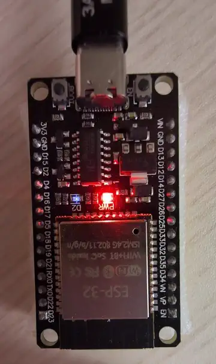
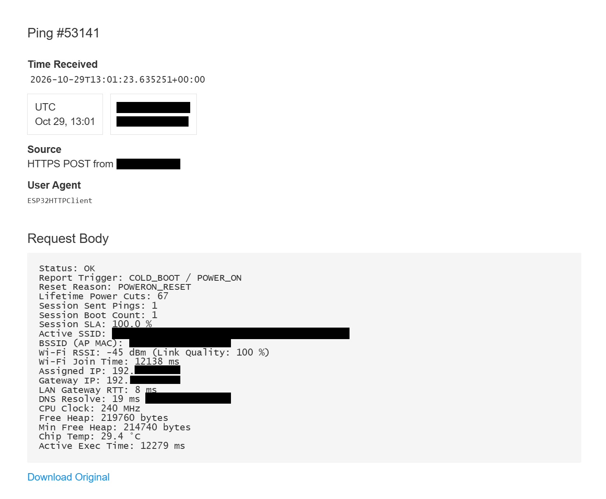
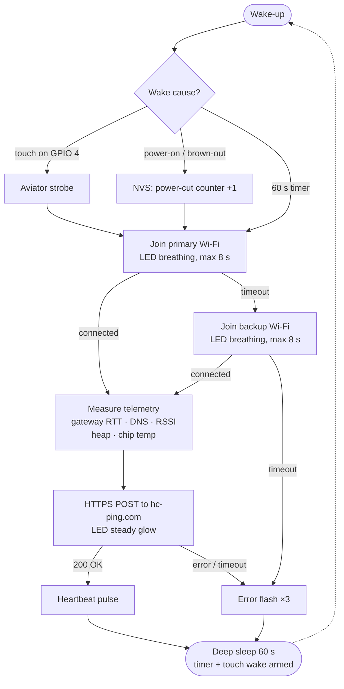
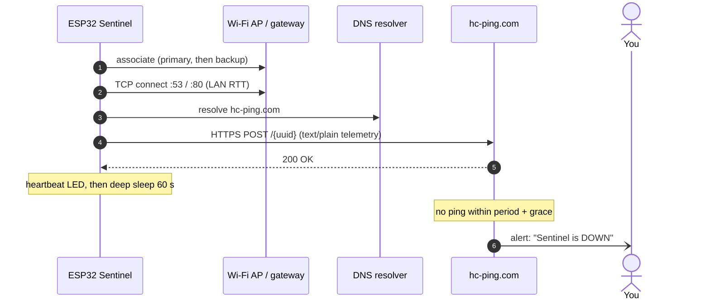
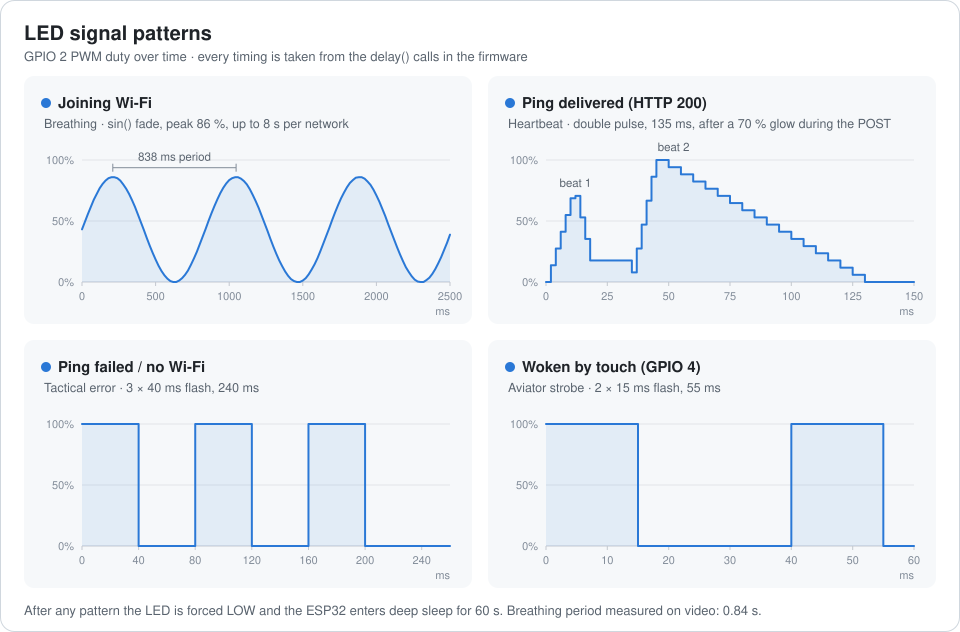

<div align="center">

# ESP32 Sentinel Watchdog

**A dead-man's switch for your network and power.**<br>
An ESP32 wakes every 60 seconds, joins Wi-Fi (with failover), measures link and system health,<br>
and posts a full telemetry report to [healthchecks.io](https://healthchecks.io). If the pings stop, you get alerted.

[](https://github.com/espressif/arduino-esp32)
[](https://www.arduino.cc/en/software)
[](https://healthchecks.io)
[](#how-it-works)
[](LICENSE)

<table>
  <tr>
    <td align="center" valign="top">
      
      <br><sub>Breathing while joining Wi-Fi → heartbeat flash<br>on <code>HTTP 200</code> → deep sleep</sub>
    </td>
    <td align="center" valign="top">
      
      <br><sub>A real report as received by healthchecks.io<br>(network identifiers redacted)</sub>
    </td>
  </tr>
</table>

</div>

---

## Why

A healthchecks.io check expects a ping every minute. When the house loses power, the router hangs, the ISP drops,
or the Wi-Fi dies, **the ping doesn't arrive and healthchecks.io alerts you** by email, Telegram, Signal, Slack, ntfy and more.
The ESP32 costs a few euros, and each ping carries a diagnostic snapshot so you can see *why* something went wrong.

## Features

- **Wi-Fi failover.** Tries the primary network for up to 8 s, then the backup network.
- **Rich telemetry in every ping.** RSSI, BSSID, join time, LAN gateway RTT, DNS latency, heap, chip temperature and awake time.
- **Power-outage counter in flash (NVS).** It survives power loss, so you can count every blackout over the device's lifetime.
- **Session SLA in RTC memory.** Successful / failed pings since the last power-on, kept through deep sleep.
- **Reset forensics.** Tells a cold boot from a brown-out (weak PSU), a software reset or a normal timer wake.
- **Touch-to-ping.** Touch the wire on GPIO 4 to wake the board and send an extra report at any time.
  The touch threshold adapts to the current grounding/PSU on every cycle.
- **One-LED status language.** Breathing, heartbeat, error flash and strobe ([see below](#led-language)).
- **No external libraries.** Only what ships with the ESP32 Arduino core.

## How it works





## LED language

<p align="center">
  
</p>

| Pattern | When | Meaning |
|---|---|---|
| **Breathing** (slow sine fade) | joining Wi-Fi | Connecting to the primary or backup network |
| **Steady glow** (70 %) | during the HTTPS POST | Report is being uploaded |
| **Heartbeat** (double pulse) | after `HTTP 200` | Ping delivered, all good |
| **Tactical error** (3 sharp flashes) | Wi-Fi or HTTP failure | Nothing was delivered this cycle |
| **Aviator strobe** (2 tiny flashes) | right after waking | The wake came from the touch pad |
| *dark* | deep sleep | Sleeping for 60 s |

## Telemetry payload

Every ping carries a plain-text body that healthchecks.io stores and shows next to the event:

| Field | Source | What it tells you |
|---|---|---|
| `Report Trigger` | wake-up cause | `TIMER (60s Auto)`, `TOUCH (GPIO 4 Ping)` or `COLD_BOOT / POWER_ON` |
| `Reset Reason` | ROM reset register | `POWERON_RESET`, `DEEPSLEEP_RESET`, `BROWNOUT_RESET`, `SW_RESET`, … |
| `Lifetime Power Cuts` | NVS flash | Power-on and brown-out resets since first flash, survives outages |
| `Session Sent Pings` · `Boot Count` · `SLA` | RTC memory | Reliability since the last power-on |
| `Active SSID` | Wi-Fi | Which network was used, `(FAILOVER)` if it was the backup |
| `BSSID (AP MAC)` | Wi-Fi | Which access point / mesh node served the board |
| `Wi-Fi RSSI` · `Link Quality` | Wi-Fi | Signal strength, quality = `2 × (RSSI + 100)` clamped to 0–100 % |
| `Wi-Fi Join Time` | timer | Association + DHCP time (> 8 s means the primary failed) |
| `Assigned IP` · `Gateway IP` | DHCP | Current lease |
| `LAN Gateway RTT` | TCP connect to gateway `:53`/`:80` | Local network latency |
| `DNS Resolve` | `hostByName("hc-ping.com")` | DNS latency and resolved address |
| `CPU Clock` · `Free Heap` · `Min Free Heap` | ESP API | System health, leak detection |
| `Chip Temp` | internal sensor | Rough on-die temperature |
| `Active Exec Time` | timer | How long the board was awake this cycle |

<details>
<summary>Example body</summary>

```text
Status: OK
Report Trigger: COLD_BOOT / POWER_ON
Reset Reason: POWERON_RESET
Lifetime Power Cuts: 67
Session Sent Pings: 1
Session Boot Count: 1
Session SLA: 100.0 %
Active SSID: <your-ssid>
BSSID (AP MAC): xx:xx:xx:xx:xx:xx
Wi-Fi RSSI: -45 dBm (Link Quality: 100 %)
Wi-Fi Join Time: 12138 ms
Assigned IP: 192.168.x.x
Gateway IP: 192.168.x.x
LAN Gateway RTT: 8 ms
DNS Resolve: 19 ms (x.x.x.x)
CPU Clock: 240 MHz
Free Heap: 219760 bytes
Min Free Heap: 214740 bytes
Chip Temp: 29.4 °C
Active Exec Time: 12279 ms
```

</details>

## Hardware

| Part | Notes |
|---|---|
| ESP32 dev board (ESP32-WROOM-32 / DevKit V1) | Classic ESP32. The touch and temperature APIs differ on S2/S3/C3 |
| On-board LED, **GPIO 2** | Driven with PWM (`analogWrite`) |
| Touch electrode, **GPIO 4** (T0) | Optional: a short wire, foil or a coin |
| USB power supply | Brown-outs are detected and reported |

## Getting started

1. **Create a check** on [healthchecks.io](https://healthchecks.io): set *Period* to **1 minute** and *Grace* to **2 minutes**
   (one cycle is 60 s of sleep plus up to ~25 s awake). Copy the UUID from the ping URL `https://hc-ping.com/<uuid>`.
2. **Clone the repo**

   ```bash
   git clone https://github.com/olekkut/esp32-sentinel-watchdog.git
   cd esp32-sentinel-watchdog
   ```

3. **Add your credentials.** Copy the template and fill it in. `secrets.h` is git-ignored:

   ```bash
   cp secrets.example.h secrets.h
   ```

   ```cpp
   #define SECRET_PRIMARY_SSID     "your-primary-ssid"
   #define SECRET_PRIMARY_PASSWORD "your-primary-password"
   #define SECRET_BACKUP_SSID      ""   // "" disables failover
   #define SECRET_BACKUP_PASSWORD  ""
   #define SECRET_HC_UUID          "00000000-0000-0000-0000-000000000000"
   ```

4. **Flash it.** In Arduino IDE 2.x install **esp32 by Espressif Systems** (3.x) from the Boards Manager,
   select **ESP32 Dev Module** and upload. Serial monitor: `115200` baud.

## Configuration

| Setting | Where | Default |
|---|---|---|
| Sleep interval | `TIME_TO_SLEEP` | `60` s |
| LED pin | `LED_PIN` | `2` |
| Touch pin | `TOUCH_PIN` | `4` |
| Wi-Fi timeout per network | `setup()` | `8000` ms |
| HTTP timeout | `http.setTimeout()` | `7000` ms |

## Security notes

- Wi-Fi passwords and the ping UUID live only in `secrets.h`, which is listed in `.gitignore`.
- **Treat the ping UUID like a password:** anyone who has it can send fake "OK" pings. If it leaks,
  delete the check and create a new one.
- The firmware uses `WiFiClientSecure::setInsecure()`. Traffic is encrypted, but the server certificate is not verified.
  For stricter setups, pin the root CA with `client.setCACert(...)`.

## Repository layout

```text
esp32-sentinel-watchdog/
├── esp32-sentinel-watchdog.ino   # firmware
├── secrets.example.h             # credentials template -> copy to secrets.h
├── docs/
│   ├── demo.webp                 # looping demo of the LED cycle
│   ├── led-patterns.svg          # LED timing chart (light/dark aware)
│   └── healthchecks-ping.jpg     # example report on healthchecks.io
├── .gitignore
└── LICENSE
```

## License

[MIT](LICENSE) © 2026 Aleksander Kutycki
